# Digimax

**Every format. One studio.** · [digimax.mu](https://digimax.mu) · info@digimax.mu

Digimax Ltd takes an idea from screen to paper, photo or solid object: print, photography, 3D printing, and websites with interactive 3D. When the software we needed didn't exist, we wrote it. This is where the open-source parts live.

### Work

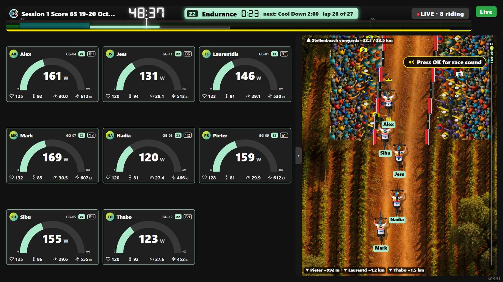

**Grannygear: a complete indoor cycling studio, Cape Town.** Every bike gets a tablet showing power, cadence and heart-rate zones, and the whole class rides together on the big screen with an instructor clock everyone follows. Behind it: a ride app that runs on tablets as old as Chrome 81, a Windows app, a TV app, an Android bridge that talks ANT+ and Bluetooth to trainers, power meters, heart-rate straps and handlebar controllers, and a staff portal for bikes, riders and workouts. Built and run on Cloudflare.

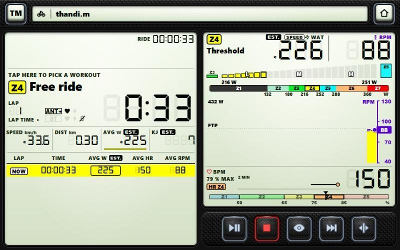 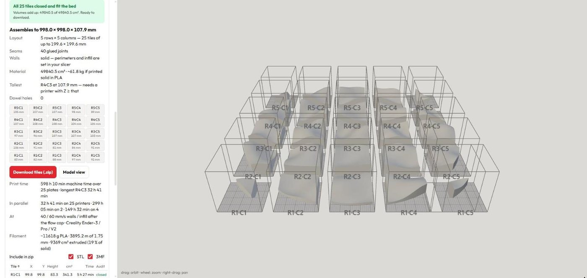

**STL Splitter.** Born on a museum job: a terrain model far too big for any printer, and the splitter we tried left open edges. Ours cuts it into tiles that fit the bed and checks every tile is a sealed solid before you can download it, with print time and filament per tile. Free, in the browser, nothing uploaded. [Open it](https://digimaxstlsplitter.pages.dev)

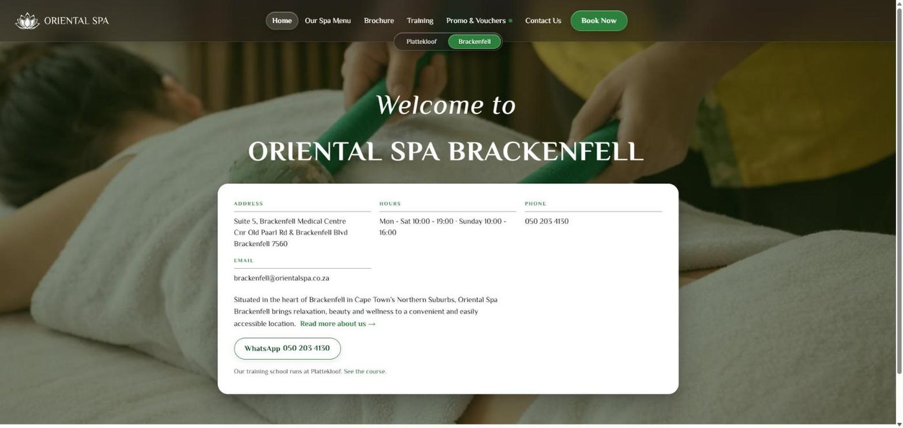

**Oriental Spa: two branches on one system.** Website, online booking, gift vouchers with QR redemption at reception, staff and therapist apps, menu QR cards and printed brand pieces. Every staff app has a one-tap "Fix it" button, and a watchdog checks the system every 15 minutes and tells us before the spa notices.

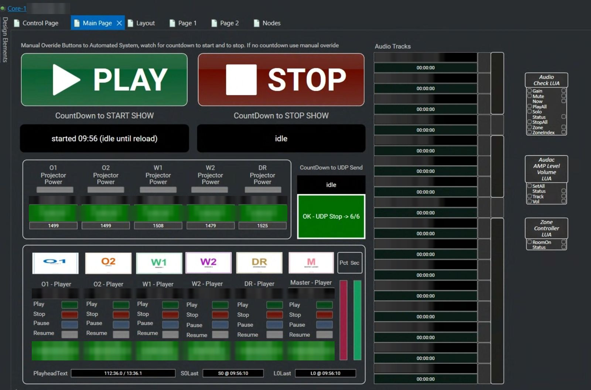

**Museum show control, Iziko Museums of South Africa.** Six BrightSign video players, five projectors and sixteen audio tracks run one synchronised show that starts and stops itself every day. We wrote the Q-SYS Lua controllers that run on the audio core: countdown timers for the daily start and stop, a sync receiver that keeps audio locked to the video's loop marker, a master that broadcasts start and stop to every player, and a gate that keeps projectors in step with the show. The manual Play and Stop buttons stay as an override.

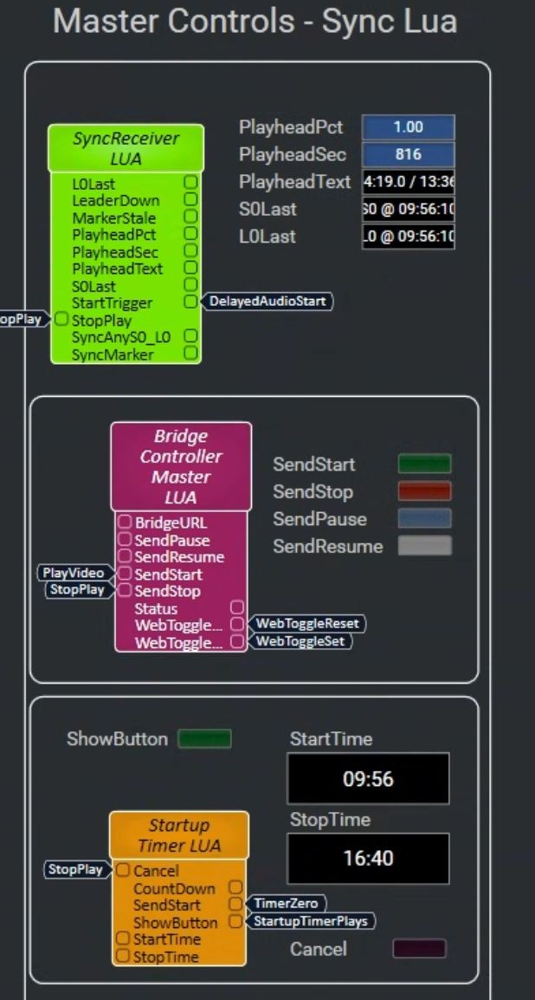 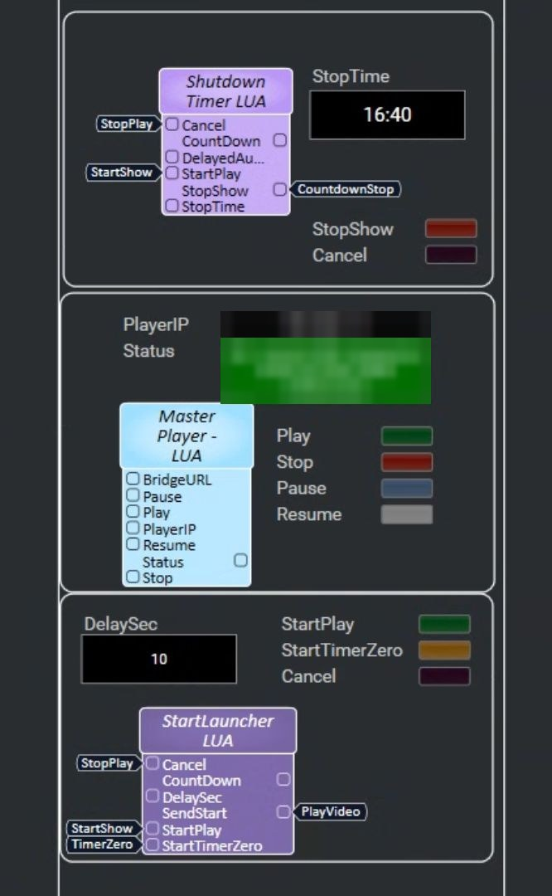 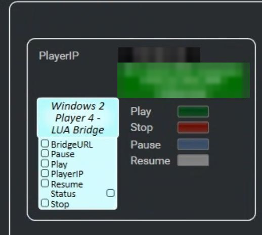

Each controller documents itself in its header, so the operator can change the show without a developer:

```lua
--[[ startup_timer.lua: countdown to the daily show start
  Pair with shutdown_timer.lua:
     startup_timer  StartShow ──► show_button.Play     @ 09:55
     shutdown_timer StopShow  ──► show_button.Reset    @ 16:40
  Both read their time from a Text input pin, so changing the
  schedule means editing the StartTime / StopTime field. No rebuild.

  Behaviour, armed automatically on load:
    - Inside the show window: start now (a mid-day reload recovers the show)
    - Otherwise: count down to the next StartTime and fire at zero
  The Core has no NTP, so the clock is synced from the bridge and every
  tick recomputes time-left from the wall clock: it never drifts.
]]
```

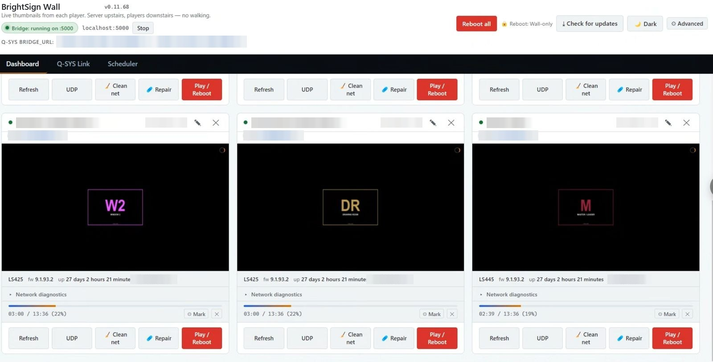

The BrightSign Wall app shows a live thumbnail from every player, its uptime and playhead, and one-click repair. Server upstairs, players downstairs: no walking.

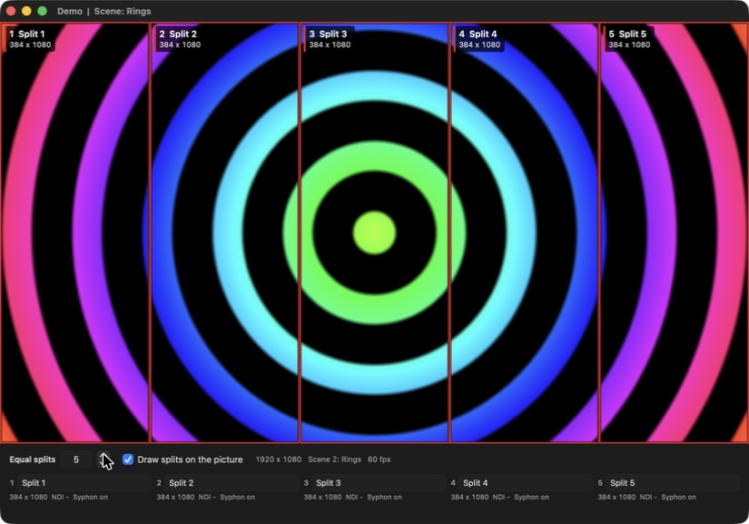

**OVS, Open Video Split: one film across many projectors.** A Mac player for permanent projection shows. It plays a single very wide film, cuts it into named splits and hands each split to the mapping software over NDI or Syphon, so one file feeds every projector. A second computer can watch the layout in a browser. It plays the film's sound to a chosen device, on a player of its own so that a fault on the sound side cannot disturb the picture. It loops without losing a frame, takes OSC commands, reports its own health on a status page, starts by itself at login and restarts if it stops. In development: on a MacBook Pro it plays a 15720 x 2812 ProRes film at 30 frames a second and sends five slices with none dropped. Not yet running in a venue.

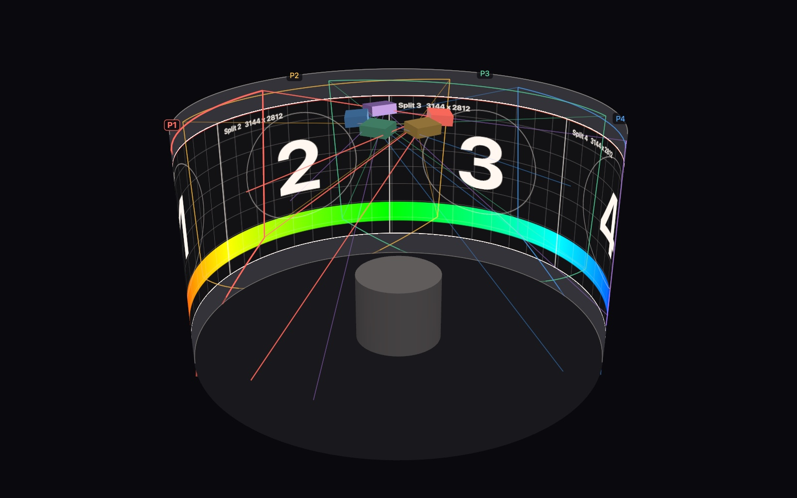

**OM, OpenMapper: the room in numbers before the projectors are switched on.** A Mac mapping and blending tool that follows OVS. The room and its projectors are described in measurements; OM works out what each projector must show and how neighbours share the light where they overlap, and draws the room in 3D with the film on its wall as the projectors would deliver it. It says in plain words where a rig does not reach, how sharp the picture arrives and how uneven the light is, so a mounting plan can be corrected at a desk. In development: the arithmetic, the report and the 3D preview exist. It does not yet drive a projector.

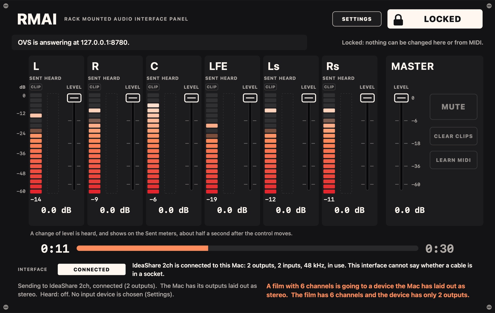

**RMAI: a front panel for a rack audio interface that has none.** A Mac panel for the sound of a projection show. OVS plays the film's sound in step with the picture; RMAI shows a meter for each channel sent and each input heard, the film's progress and the state of the interface, and sets the levels from the screen or a MIDI knob box. It starts locked, so a stray touch changes nothing. In development: it has run against OVS with a six-channel test film. No sound has yet been played through a real interface.

### Open source

| Tool | What it does |
|---|---|
| [digimaxstlsplitter](https://github.com/digimax-mu/digimaxstlsplitter) | Splits a model too big for any printer into tiles that fit the bed, and checks every tile is a sealed solid before you download it. Runs in your browser, nothing is uploaded. [Open it](https://digimaxstlsplitter.pages.dev) |
| [digimax-transcriber-android](https://github.com/digimax-mu/digimax-transcriber-android) | Records with the screen locked and transcribes on the phone. No network permission. |

Both are MIT licensed. The Digimax name, logo and artwork are not.

Mauritius · [digimax.mu](https://digimax.mu)
